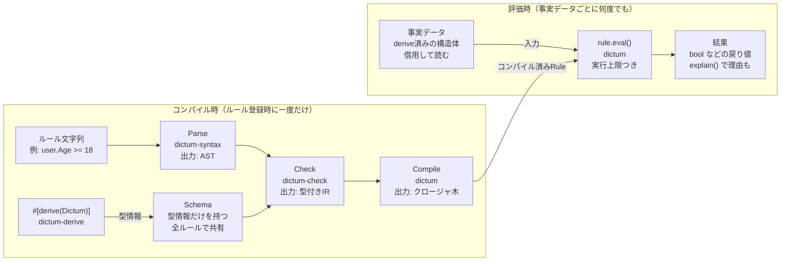

# dictum 設計ドキュメント

2026-11-18

## 概要

dictumは[expr-lang](https://expr-lang.org/)（Go）の構文を引き継いだRust製の式言語で、ルールエンジンへの組み込みを第一の用途とする。ルールは一度コンパイルし、多数の事実データに対して安全かつ高速に繰り返し評価する。

このドキュメントは言語と外部APIの仕様を定める。クレートの内部構成、各決定の理由、退けた案は[アーキテクチャ](architecture.md)（英語）にまとめた。

### 目標

- expr-langと同じ構文（リテラル、演算子、述語、pipe、let）を受け付ける
- コンパイル時に静的型チェックを行い、ルールの戻り値型（通常は `bool`）を固定できる
- 副作用がなく、実行上限によって必ず停止する評価（ユーザー定義関数が副作用を持たず停止する限り）
- コンパイル済みルールは `Send + Sync` で、複数スレッドから共有できる
- 「なぜマッチしたか／しなかったか」を返すexplain機能

### 非目標

- Go版との挙動の完全互換（エラーメッセージや数値の細かい規則）
- 汎用スクリプト言語化（ループ、代入、I/O）
- 初期段階でのバイトコードVM

## Go版exprとの差分

構文は同じだが、曖昧な挙動は「コンパイル時に弾く」「実行時に黙って値を変えない」方向に寄せる。

| 項目 | expr-lang（Go） | dictum |
| --- | --- | --- |
| 整数オーバーフロー | 値が一周する | `EvalErrorKind::Overflow` |
| 文字列の添字とスライス | バイト単位。文字の途中でも切れる | バイト単位。文字の途中を指すと `EvalErrorKind::CharBoundary` |
| 存在しないフィールド | 設定次第でnilかエラー | コンパイルエラー |
| nilになりうる値 | どの値もnilになりうる | `Option<T>` 型だけ。`?.` と `??` でのみ扱える |
| `int` と `float` の混在 | 暗黙に変換 | `int` → `float` の昇格だけ。`/` は `int` 同士でも `float`、`%` は `int` のみ |
| 金額 | `float` で扱う | `Decimal` 型（`decimal` feature） |
| 比較の連鎖 `a < b < c` | `a < b && b < c` に展開。`b` を2回評価する | 同じく展開するが、`b` は1回だけ評価する |
| `a == b == c` | `(a == b) == c` | 構文エラー |
| マップの順序 | 不定 | マップリテラルは書いた順、事実データの `BTreeMap` はキー順。`HashMap` は事実データに使えない |
| `now()` | 実時刻 | `Ctx::with_now` で渡した時刻。渡さずに呼ぶと実行時エラー |
| 日時の型 | Goの `time` | `jiff` の `Timestamp` とタイムゾーン、`SignedDuration`、`jiff::tz::TimeZone`。メソッドはGo版と同じ名前と意味 |
| ローカルタイムゾーン | `time.Local`（実行するマシンのタイムゾーン） | ない。オフセットのない日時はUTCとして読み、`timezone("Local")` はエラー |
| 実行時エラー | `error` と panic が混在 | すべて `Result` |

次の2点は差分と誤解しやすいが、両者で同じである。`len` はどちらも文字数を返し、比較できない型同士の `==` はどちらもコンパイルエラーになる。

## アーキテクチャとクレート構成

コストのかかる処理（パース・型チェック・最適化）はルール登録時に一度だけ行い、評価時はクロージャ木に事実データを渡すだけにする。



上段がコンパイル、下段が評価。`Schema` の型情報と、事実データのフィールドを読み出す実装は、どちらも同じ `#[derive(Dictum)]` から生成される。そのため、derive した型については型情報と実際のデータが食い違わない。

| クレート | 責務 | 主な依存 |
| --- | --- | --- |
| `dictum-syntax` | Lexer、Parser、AST、Span、`Diagnostic` と `ErrorCode`、組み込み関数の名前の一覧 | なし |
| `dictum-check` | `Type`、構造体の型情報 `StructDesc`、型付きIR、Checker | `dictum-syntax`、`jiff` |
| `dictum` | 外部向けAPI（`Rule`、`RuleSet`、`Schema`、`Ctx`）と、非公開の評価エンジン（`Value`、定数の畳み込み、クロージャコンパイル、組み込み関数、実行上限、explain） | 上記すべて、`regex`、`libm` |
| `dictum-derive` | `#[derive(Dictum)]` | `syn`、`quote`、`dictum-syntax` |
| `dictum-cli` | CLIとREPL（バイナリ `dictum`）。TOMLのスキーマとJSONの事実データを読む | `dictum`（`runtime-schema`）、`toml`、`serde_json` |

評価エンジンは `dictum` の非公開モジュールに置く。別クレートにすると、`dictum` から使うために評価エンジンの内部型を公開しなければならず、利用者からもimportできてしまうためである。

### MSRVと `no_std`

MSRVはRust 1.85。edition 2024 は1.85以上を要求するので、これより下げられない。MSRVを上げるのはマイナーバージョン更新時だけとし、CIで常に1.85をテストする。

全クレートを `#![no_std]` + `alloc` で書き、`std` は既定で有効なfeatureにする。`std` の有無で評価結果は変わらない。

| 依存 | `no_std` での使い方 |
| --- | --- |
| `regex` | `default-features = false` で `alloc` のみ（1.13.1のソースで確認）。`std` がないと内部でスピンロックを使う |
| `jiff` | `alloc` のみ。`tzdb` feature（既定で有効）では `tzdb-bundle-always` でIANAのタイムゾーンDB（約200 KB）をバイナリに埋め込む。DBの埋め込みも `alloc` だけで動くので、`no_std` でも `timezone("Asia/Tokyo")` が使え、どのマシンでも同じタイムゾーンになる。利用側が jiff の `tz-system` を有効にしても、`timezone()` は埋め込んだDBだけを引く |
| `libm` | `floor` `ceil` `round` `pow` は `core` にないので、`std` の有無にかかわらず常に `libm` を使う。ターゲット間で結果がビット単位で一致する |
| `rust_decimal` | `default-features = false` |

ハッシュ関数を使うデータ構造は持たない。定数配列への `in` はソート済み配列の二分探索、マップリテラルは書いた順の配列で表す。

エラー型は `core::error::Error` を実装する。時刻は呼び出し側が `Ctx` に渡すので、時計のない `no_std` 環境でも `now()` を呼ばないルールはそのまま動く。`no_std` でのビルドは `thumbv7em-none-eabihf` 向けにCIで確認する。

## 構文仕様

字句と文法は[expr-langの言語定義](https://expr-lang.org/docs/language-definition)に合わせ、優先順位だけdictumとして明文化する。パーサは手書きのPrattパーサ。

### 字句規則

| 種類 | 規則 | 例 |
| --- | --- | --- |
| コメント | `//` 行末まで、`/* */` ブロック | `// note` |
| 識別子 | `[A-Za-z_][A-Za-z0-9_]*` と `$env` | `user`, `$env` |
| 整数 | 10進・`0x`・`0o`・`0b`、`_` 区切り可 | `1_000`, `0x2A` |
| 浮動小数 | 小数点または指数つき | `0.5`, `.5`, `1e3` |
| 文字列 | `"` か `'`（`\n` `\t` `\uXXXX`）、バッククォートは生文字列 | `'admin'` |
| バイト列 | `b"..."`（`\xNN` `\NNN`） | `b"\x00"` |
| 予約語 | `true false nil let if else not and or in matches contains startsWith endsWith` | |
| 述語内の参照 | `#`、`#index`、`#acc`、`.Field` | `.Age > 18` |

### 文法（EBNF）

```
program     = { "let" ident "=" expr ";" } expr ;
expr        = conditional ;
conditional = binary [ "?" [ expr ] ":" expr ]    (* a ?: b は a ? a : b *)
            | "if" expr "{" expr "}" "else" ( "{" expr "}" | conditional ) ;
binary      = unary { binop unary | "|" call } ;   (* 優先順位は下の表。pipeは順位2 *)
unary       = ( "not" | "!" | "-" | "+" ) unary | postfix ;
postfix     = primary { "." ident | "?." ident | "[" index "]" | "?.[" index "]" } ;
index       = expr | [ expr ] ":" [ expr ] ;
primary     = literal | call | ident | "$env" | pointer | "." ident
            | "(" expr ")" | "[" [ args ] "]" | "{" [ pairs ] "}" ;
call        = ident "(" [ args ] ")" ;
pointer     = "#" [ "index" | "acc" ] ;
args        = arg { "," arg } [ "," ] ;
arg         = expr | "{" expr "}" ;                (* 述語の括弧は省略可 *)
pairs       = key ":" expr { "," key ":" expr } [ "," ] ;
key         = ident | string | "(" expr ")" ;
```

`a | f(b)` はパース時に `f(a, b)` へ脱糖する。述語内の `.Field` は `#.Field` に変換する。関数を呼べるのは `名前(引数)` の形と、メンバーの後ろに引数を続けたメソッド呼び出し `x.Name(引数)`、`x?.Name(引数)` だけで、関数は値として扱えない。`f(x)(y)` や `(a)(b)` のように、名前でもメンバーでもない式に `(` を続けるとE0108になる。メソッドを持つのは時刻、期間、タイムゾーンだけで、どのメソッドを呼ぶかはCheckerが受け手の型から1つの表で決める。表にないメソッドはE0214になる。

### 演算子の優先順位（低い→高い）

| 順位 | 演算子 | 結合 | Go版の値 |
| --- | --- | --- | --- |
| 1 | `? :`、`?:`、`if else` | 右 | 二項演算子をすべて読んだ後に処理 |
| 2 | `\|`（pipe） | 左 | 0 |
| 3 | `or` `\|\|` | 左 | 10 |
| 4 | `and` `&&` | 左 | 15 |
| 5 | `<` `>` `<=` `>=` | 連鎖 | 20 |
| 5 | `==` `!=` `in` `not in` `matches` `contains` `startsWith` `endsWith` | 非結合 | 20 |
| 6 | `..` | 非結合 | 25 |
| 7 | `+` `-` | 左 | 30 |
| 8 | 単項 `not` `!` | 前置 | 50 |
| 9 | `*` `/` `%` | 左 | 60 |
| 10 | 単項 `-` `+` | 前置 | 90 |
| 11 | `**` `^` | 右 | 100 |
| 12 | `??` | 左 | 500 |
| 13 | `.` `?.` `[]` `[:]` | 後置 | |

順位は[Go版の `operator.go` と `parser.go`](https://github.com/expr-lang/expr/tree/master/parser)（2026年7月のmain）で確認し、すべてGo版に合わせる。

- `not` は `+` より強く `*` より弱い。`not a == b` は `(not a) == b` になる（Rustの `!a == b` と同じ）。
- `??` は他の二項演算子と括弧なしで混ぜられない。`a ?? 0 + 1` はエラーで、`(a ?? 0) + 1` と書く。
- `-2 ** 2` は `-(2 ** 2)`。`a | f() ? x : y` は `f(a) ? x : y`。
- 単項演算子は自分の順位で被演算子を読み、その後は外側の順位で二項演算子を読み続ける（Go版の `parseExpression` と同じ）。`not a * b` は `not (a * b)`、`a * not b + c` は `(a * (not b)) + c` になる。
- pipeも二項演算子の並びの中で読む。右辺は `名前(引数)` の呼び出しだけで、後ろに `.` や `[` は続けられない。`1 + 2 | f()` は `f(1 + 2)`、`a | f() + 1` は `f(a) + 1`。
- 大小比較は連鎖できる。`18 <= user.Age < 65` は `18 <= user.Age && user.Age < 65` と同じ意味で、短絡評価する。中央の `user.Age` は1回だけ評価し、explainでは比較ごとの子ノードになる。
- `<` と `>` のように向きを混ぜてもよい（Go版と同じ）。`==` `!=` `in` などは連鎖できず、`a == b == c` は構文エラー。
- 式の入れ子は128段（`MAX_DEPTH`）までで、超えるとE0105。後段の処理と評価はすべて再帰で書くので、この上限でスタックの使用量を抑える。`&&` と `||` の並びは1つのノードにまとめるので、長い論理式はこの上限に当たらない。

## ASTとSpan

全ノードがソース上のバイト範囲 `Span` を持ち、型エラーも実行時エラーもexplainもこのSpanで位置を示す。ASTは1回のコンパイルの間しか使わず、型付きIRで名前がすべて番号に置き換わるので、識別子はインターンせずソースを借用する（`&'src str`）。

```rust
#[derive(Clone, Copy, Debug, PartialEq, Eq)]
pub struct Span { pub start: u32, pub end: u32 }   // バイトオフセット

pub struct Program<'src> { pub lets: Vec<Let<'src>>, pub body: Expr<'src> }
pub struct Let<'src> { pub name: Ident<'src>, pub value: Expr<'src> }
pub struct Expr<'src> { pub kind: ExprKind<'src>, pub span: Span }

pub enum ExprKind<'src> {
    // リテラル
    Nil, Bool(bool), Int(i64), Float(f64),
    Str(Cow<'src, str>), Bytes(Cow<'src, [u8]>),   // エスケープがなければ借用
    Array(Vec<Expr<'src>>),
    Map(Vec<(MapKey<'src>, Expr<'src>)>),
    // 参照
    Ident(&'src str),
    Env,                                           // $env
    Pointer(Pointer),                              // #, #index, #acc
    // 演算
    Unary   { op: UnaryOp, expr: Box<Expr<'src>> },
    Binary  { op: BinaryOp, lhs: Box<Expr<'src>>, rhs: Box<Expr<'src>> },
    Logic   { op: LogicOp, operands: Vec<Expr<'src>> },   // && と || の並び（2個以上）
    Compare { first: Box<Expr<'src>>, rest: Vec<(CompareOp, Expr<'src>)> },  // 比較の連鎖
    Member  { obj: Box<Expr<'src>>, key: MemberKey<'src>, optional: bool },
    Slice   { obj: Box<Expr<'src>>, from: Option<Box<Expr<'src>>>, to: Option<Box<Expr<'src>>>, optional: bool },
    Call    { callee: Callee<'src>, callee_span: Span, args: Vec<Expr<'src>> },
    Predicate(Box<Expr<'src>>),                    // all(xs, { ... }) の本体
    // 制御
    Conditional { cond: Box<Expr<'src>>, then: Box<Expr<'src>>, otherwise: Box<Expr<'src>> },
    // エラー回復
    Error,                                         // 構文エラーの箇所。Parserが置く
}

pub enum Callee<'src> { Builtin(Builtin), Func(&'src str) }   // 組み込み関数か、Schemaの関数
pub enum Pointer { Current, Index, Acc }
```

- pipe、述語内の `.Field`、`?:` はパーサで脱糖するので、ASTに専用ノードはない。`let` は文法どおりプログラムの先頭にだけ置ける。
- `user.Name` と `user["Name"]` はどちらも `Member` になり、キーが定数ならCheckerがフィールド番号に解決する。
- 初期実装は `Box` で組む。パース速度が問題になったらアリーナ化を検討する。

## 型システムとSchema

CheckerはASTと `Schema` から、型を確定しフィールドを番号に解決した型付きIRを作る。型が分からない箇所だけ `Any` にして実行時チェックを挿入する。

```rust
pub enum Type {
    Any, Nil, Bool, Int, Float, String, Bytes, Time, Duration, Location,
    #[cfg(feature = "decimal")]
    Decimal,
    Array(Arc<Type>),
    Map(Arc<Type>),                 // キーは常に文字列
    Option(OptionType),             // Type::option(t) で作る
    Struct(&'static StructDesc),    // deriveが static として生成
}

pub struct StructDesc { name: &'static str, fields: &'static [FieldDesc] }
pub struct FieldDesc { name: &'static str, ty: fn() -> Type }
```

- `Type` に関数の型とエラー用の型はない。関数は値でないので関数の型は要らず、型エラーの箇所はChecker内部の型で印を付けるので、型付きIRに入る `Type` は常に実際の型になる。
- `Time` はGoの `time.Time` と同じく、瞬間と、それを表示するタイムゾーンを持つ。`==` や `<` は瞬間だけを比べ、タイムゾーンは `Year()` などのメソッド、`Format`、`string()`、`toJSON` の結果に効く。`Location` はタイムゾーンで、`==` では比べられない（Goはポインタを比べるので、同じ名前でも別に読み込むと等しくならない）。
- `OptionType` の中身は非公開で、`Option<Option<T>>` や `Option<Nil>` は作れない。
- `StructDesc` は `static` に置くので、アドレスの同一性が型の同一性になる。`FieldDesc::ty` を関数にしているのは、`static` の初期化式で `Arc` を作れず、また再帰的な構造体（`children: Vec<Node>`）を遅延初期化なしで表すためである。

### 型付け規則（主なもの）

| 式 | 規則 | 結果の型 |
| --- | --- | --- |
| `Int + Int` | オーバーフローで実行時エラー | `Int` |
| `Int + Float` | `Int` を `Float` に昇格 | `Float` |
| `a / b` | `Int` と `Float` のどの組み合わせでも | `Float` |
| `a ** b` | | `Float` |
| `Decimal + Int` | `Int` を `Decimal` に昇格 | `Decimal` |
| `Decimal / Decimal` | ゼロ除算と桁あふれは実行時エラー | `Decimal` |
| `Decimal + Float` | コンパイルエラー。`decimal(x)` か `float(d)` で明示する | |
| `String + String` | 連結 | `String` |
| `s[i]`、`s[i:j]` | バイト位置。文字境界でなければ実行時エラー | `String` |
| `xs[i]`（`xs: Array<T>`） | 負の添字は末尾から数える。範囲外は実行時エラー | `T` |
| `m[k]`（`m: Map<T>`） | | `Option<T>` |
| `Time - Time` | | `Duration` |
| `x.f`（`x: Option<S>`） | コンパイルエラー。`?.` が必要 | |
| `x?.f`（`x: Option<S>`, `f: T`） | | `Option<T>` |
| `x?.f`（`x: S`） | `.` と同じ | `T` |
| `a ?? b`（`a: Option<T>`, `b: T`） | | `T` |
| `x in xs`（`xs: Array<T>`） | `x` は `T` と比較可能 | `Bool` |
| `all(xs, p)` | `p` は `#: T` で `Bool` | `Bool` |
| `x ⊕ Any` | 実行時に型を確認 | 演算子による |

`Decimal` は `rust_decimal::Decimal`。構文を変えないため専用リテラルは設けず、事実データのフィールドか `decimal("19.99")` で作る。定数引数の `decimal()` はコンパイル時に値へ畳み込む。

### Schema API

事実データの根になる構造体を1つ `#[derive(Dictum)]` し、そのフィールドをルールの変数にする。`$env` はこの根の構造体を指す。

```rust
#[derive(Dictum)]
#[dictum(rename_all = "PascalCase")]      // ルールでは user.Age と書く（Go版と同じ）
pub struct User {
    pub age: i64,
    pub group: String,
    pub email: Option<String>,
    pub tags: Vec<String>,
    pub attrs: Dynamic,                   // ルールでは any 型（JSONの属性など）
    #[dictum(skip)]
    pub password_hash: [u8; 32],
}

/// スキーマの根。フィールドがルールの変数 user と order になる
#[derive(Dictum)]
pub struct Facts<'a> { pub user: &'a User, pub order: &'a Order }
type F = Facts<'static>;

let schema: Schema<F> = Schema::<F>::builder()
    .pure_func("isHoliday", |t: Timestamp| is_holiday(t))
    .build()?;                            // Cloneは Arc の複製
```

- 変数を名前と型で1つずつ登録するAPIはない。変数の一覧が事実データの型とは別にあると、両者をそろえ続ける必要があるためである。複数のデータ源は、根の構造体に参照のフィールドとして並べる。
- `Schema<F>` は事実データの型 `F` を型引数に持つ。`F` は根の構造体の `'static` 版で、`Facts<'a>` のように部品を借用する根も、`Facts<'static>` に対してコンパイルしたルールで評価できる。

`#[derive(Dictum)]` はフィールドのRust型から `Type` を作る。対応は次のとおりで、これ以外の型はRustのコンパイルエラーになる。

| Rust型 | dictumの型 |
| --- | --- |
| `bool` | `Bool` |
| `i8` `i16` `i32` `i64` `u8` `u16` `u32` | `Int` |
| `f32` `f64` | `Float` |
| `String` `&str` `Box<str>` | `String` |
| `jiff::Timestamp`（UTCで表示）、`jiff::Zoned`（そのタイムゾーンで表示）、`jiff::SignedDuration`、`jiff::tz::TimeZone` | `Time`、`Time`、`Duration`、`Location` |
| `Option<T>` | `Option` |
| `Vec<T>` `Box<[T]>` `&[T]` | `Array` |
| `BTreeMap<String, T>` | `Map` |
| `&T` `Box<T>` | `T` と同じ |
| `dictum::Dynamic` | `Any` |
| derive済みの構造体 | `Struct` |

- `HashMap` は使えない。反復順が決まらず、`keys(m)` の結果が実行ごとに変わるためである。
- `u64`、`usize`、`i128` は `int`（`i64`）に収まらない値を持ちうるので使えない。
- 型引数を持つ構造体とenumはderiveできない。`StructDesc` を `static` に置くので、型ごとに別の記述子を作れないためである。
- 式中の名前は `#[dictum(rename_all = "PascalCase" | "camelCase")]` と `#[dictum(rename = "Age")]` で変えられる。予約語（`contains` など）や識別子として不正な名前はderiveがエラーにする。`#[dictum(skip)]` のフィールドはルールから見えない。

## 評価エンジン

型付きIRを型ごとに特化したクロージャの木へ変換し、評価時はその木を呼ぶだけにする。値は事実データを借用する `Value<'a>` で、文字列や構造体をコピーしない。

### Value

`Value` の内部表現は `dictum` の外に公開しない。

```rust
pub struct Value<'a>(Repr<'a>);

enum Repr<'a> {
    Nil, Bool(bool), Int(i64), Float(f64),
    #[cfg(feature = "decimal")]
    Decimal(rust_decimal::Decimal),
    Str(Str<'a>),               // Borrowed(&'a str) | Shared(Arc<str>)
    Bytes(Bytes<'a>),
    Time(jiff::Timestamp, jiff::tz::TimeZone),   // TimeZone は8バイトなので Value は32バイトのまま
    Duration(jiff::SignedDuration),
    Location(jiff::tz::TimeZone),
    Array(Seq<'a>),             // Borrowed(&'a dyn SeqView) | Owned(Arc<[Value]>) | Range { from, to }
    Map(MapRef<'a>),            // Borrowed(&'a dyn MapView) | Owned(Arc<[(Arc<str>, Value)]>)
    Object(&'a dyn Object),     // derive済みの構造体を借用
}

pub trait Object {
    fn desc(&self) -> &'static StructDesc;
    fn field(&self, id: FieldId) -> Value<'_>;   // 名前でなく番号で引く
}
```

事実データのうち、何を借用し何をコピーするかは次のとおり。

- 借用する：文字列の中身、入れ子の構造体、配列、マップ。配列とマップは `SeqView` と `MapView` を通して要素を読むときに値を作るので、`Vec<String>` のフィールドを `Vec<Value>` に変換することはない。
- コピーする：スカラー（`bool`、整数、浮動小数、日時、期間）。日時とタイムゾーンが持つタイムゾーンは、参照カウントを増やして共有する。
- `Arc` で持つ：評価中に作った値（`filter` や `map` の結果、文字列の連結など）。
- `1..n` は配列を作らず、反復するときに要素を数える。

`Object` は `Send + Sync` を要求しない。事実データは1回の評価の間、1つのスレッドで借用するだけだからである。ルールの結果は型引数 `T` の値に変換して返すので、利用者が `Value` を扱うことはない。

### クロージャコンパイル

```rust
type Node<K> = Box<dyn for<'a> Fn(&mut Frame<'a>) -> Result<K::Out<'a>, Fault> + Send + Sync>;

struct Frame<'a> {
    root: &'a dyn Object,             // 事実データの根
    now: Option<jiff::Timestamp>,     // now() の値。None なら now() が ClockUnset
    slots: Vec<Value<'a>>,            // let 変数。本体の前に順に評価する
    scopes: Vec<Scope<'a>>,           // #, #index, #acc。内側の述語が最後
    budget: Budget,
    cache: Vec<Option<Value<'a>>>,    // RuleSet の共通部分式（後述）
}
```

- `K` はdictumの型に対応する（`IntK` なら `i64`、`BoolK` なら `bool`、型が決まらなければ `Value`）。`Int + Int` は2つの `Node<IntK>` を組み合わせるだけで、実行時の型分岐も `Value` への詰め替えもない。
- `&&` と `||` は短絡評価。述語関数（`all` など）も結果が決まった時点で止める。
- `Frame` は評価のたびに作って捨てる。コンパイル済みのルールは可変な状態を持たないので `Send + Sync` のままである。
- ベンチマークで速度不足が分かったときに、クロージャ木をバイトコードVMに後から差し替える。

### 最適化（クロージャ生成の前）

- 定数の畳み込み：`60 * 60 * 24` → `86400`。演算の意味を二重に実装しないよう、定数の部分木をクロージャにして実行し、その値で置き換える。実行時エラーになる部分木は畳み込まずに残す（`false && 1/0 > 0` もコンパイルできる）
- `pure_func` で登録した関数を定数の引数で呼んでいる箇所も、コンパイル時に呼んで畳み込む
- 定数配列への `in`：ソート済み配列の二分探索にする（要素が8個未満なら線形探索）
- `x in 1..100`：配列を作らず範囲チェックにする
- 定数パターンの `matches`：コンパイル時に `Regex` を構築する
- オーバーフロー検査の省略：フィールドのRustの型（`u8`、`i32` など）から値の範囲が分かるので、範囲を伝播させて結果が `i64` に収まると分かる演算は `checked_add` ではなく `wrapping_add` にする（`age + 1` で `age: u8` など）
- 代数的な簡約：`x + 0` → `x`、`x * 0` → `0`、`x && false` → `false`、範囲で決まる比較 → 定数など。`x * 0` のように `x` の評価を消す簡約は、`x` が失敗しえないときだけ行う
- `&&` と `||` の並べ替え：失敗しえない被演算子が続く範囲の中でだけ、安いものを先に評価する

最適化は、Leanで「エラーも含めて結果を変えない」と証明した変換だけを、証明と同じ条件で適用する。変換と定理の対応は[検証](verification.md)にまとめた。後ろの3つ（オーバーフロー検査の省略、代数的な簡約、並べ替え）は `engine/optimize.rs` が、定数の畳み込みのあとのIRに適用する。

- Leanの断片は `int` と `bool` だけなので、それ以外の型には当てない。`x + 0.0` は `x = -0.0` のとき `x` と違い、`x == x` は `NaN` のとき偽になる。
- 範囲で決める比較は、演算子が1つの `<` `<=` `>` `>=` だけにする。断片の比較はこの4つで、連鎖（`a < b < c`）は断片にないので、範囲では決めずにそのまま評価する。
- フィールドの読み出しは、どの深さでも断片の `var` と同じに扱う（失敗しえず、値はRustの型の範囲に入る）。`let` の変数と `any` の値には範囲がない。
- 実行時に記述したスキーマのフィールドには範囲がないので、範囲を使う最適化は効かない。
- `explain` は最適化しないIRを実行するので、`eval` と `explain` の差分テストが、すべての書き換えを元のルールと比べる。

### 実行上限

```rust
pub struct Limits {
    pub max_steps: u64,   // 反復した要素数の合計。超えると StepLimit（E0305）
    pub max_alloc: u64,   // 確保した要素数とバイト数の合計。超えると AllocLimit（E0306）
}
```

各ノードで数えると遅いので、データの量に比例する処理（述語の反復、`in`、`join`、`sum` など）と確保の箇所だけで数える。確保は実行する前に予算から引くので、`repeat("x", 1 << 40)` は確保を試みずにエラーになる。入れ子の深さは構文の段階で `MAX_DEPTH` に制限するので、`Limits` には含めない。

## 組み込み関数

expr-langの組み込み関数をすべて提供する。各関数はシグネチャを持ち、Checkerが引数の型を検査する。組み込み関数の名前は `dictum-syntax` の一覧1つで管理し、Checkerと評価エンジンはその一覧を網羅的に照合する。関数を一覧に足すと、型付けと実装の両方を書くまでビルドが通らない。

| カテゴリ | 関数 |
| --- | --- |
| 文字列 | `trim` `trimPrefix` `trimSuffix` `upper` `lower` `split` `splitAfter` `replace` `repeat` `hasPrefix` `hasSuffix` `indexOf` `lastIndexOf` |
| 数値 | `max` `min` `abs` `ceil` `floor` `round` `mean` `median` |
| 配列の述語 | `all` `any` `none` `one` `filter` `map` `count` `find` `findIndex` `findLast` `findLastIndex` `groupBy` `sortBy` `reduce` |
| 配列の操作 | `first` `last` `sum` `len` `join` `concat` `flatten` `uniq` `take` `reverse` `sort` |
| マップ | `keys` `values` |
| 型変換 | `int` `float` `string` `type` `decimal` `toJSON` `fromJSON` `toBase64` `fromBase64` `toPairs` `fromPairs` |
| 日時 | `now` `duration` `date` `timezone` |
| ビット演算 | `bitand` `bitor` `bitxor` `bitnand` `bitnot` `bitshl` `bitshr` `bitushr` |
| その他 | `get` |

`timezone(name)` はIANAの名前（`"Asia/Tokyo"`）からタイムゾーンを返す。名前は大文字と小文字を区別する（Linux上のGoと同じ）。`""` と `"UTC"` は `tzdb` featureがなくても使える。`"Local"` は、ルールの結果が実行するマシンで変わらないようにエラーにする。

型の付く言語にしたため、Go版と結果が変わる関数がある。`groupBy` のキーと `fromPairs` のキーは文字列に限る（マップのキーが常に文字列なので）。`reduce` の `#acc` は初期値の型、初期値がなければ要素の型を持ち、本体はその型でなければならない。`reduce` は値を際限なく入れ子にできる唯一の関数なので、入れ子が256段を超えるとE0312で止める（値をたどる再帰がスタックを使い切らないように）。`findIndex` と `findLastIndex` は見つからないときGo版のnilではなく `-1` を返す。`sort` は順序のある要素の配列なら何でも並べ、等しい要素の順を保つ。差分はそれぞれ適合テストの `deviation` に書き、`just conformance-go` が残りのケースをGo版で実行して結果が一致することを確かめる。

`indexOf` は添字と同じくバイト位置を返すので、`s[indexOf(s, "x"):]` がそのまま使える。一方、`len` は文字数を返すので、ASCII以外を含む文字列では `len` の値を添字の計算に使えない。誤って文字の途中を指した場合は `CharBoundary`（E0304）になり、エラーには添字がバイト位置であることを説明するヘルプが付く。

`duration(s)` はGo版と同じ書式（`1h30m`、`-1.5h`、`300ms`）を受け付ける。`date` の書式はGoの `time` パッケージの書式（基準時刻 `Mon Jan 2 15:04:05 MST 2006` を書きたい形で書いたもの）で、Goの `time/format.go` を移植して、解析と出力でGoと同じ文字列を受け付け、同じ文字列を出す。

- `date(s)`：Goと同じ順に `2006-01-02`、`15:04:05`、`2006-01-02 15:04:05`、RFC 3339、RFC 822、RFC 850、RFC 1123 を試す。
- `date(s, layout)`：書式を指定する。`date(s, layout, zone)`：オフセットのない日時をそのタイムゾーンで読む。どの形も先頭にタイムゾーンを置ける（`date(timezone("Asia/Tokyo"), s)`）。
- オフセットのない日時はUTC（または指定したタイムゾーン）として読み、オフセットがあればそのオフセットを保つ。夏時間で存在しない時刻や重なる時刻は、Goの `time.Date` と同じ規則で決める。
- `now(loc)` は `now()` と同じ瞬間を、そのタイムゾーンで返す。

時刻、期間、タイムゾーンのメソッドはGo版と同じ名前で、Goと同じ値を返す。

| 受け手 | メソッド |
| --- | --- |
| 時刻 | `Year` `Month` `Day` `Hour` `Minute` `Second` `Nanosecond` `Weekday` `YearDay` `Unix` `UnixMilli` `UnixMicro` `UnixNano` `Add` `Sub` `AddDate` `Before` `After` `Equal` `Compare` `Format` `In` `UTC` `Location` `Truncate` `Round` `IsZero` `String` |
| 期間 | `Hours` `Minutes` `Seconds` `Milliseconds` `Microseconds` `Nanoseconds` `Truncate` `Round` `Abs` `String` |
| タイムゾーン | `String` |

`Month()` と `Weekday()` は整数を返す（Goでは `"August"` と表示される専用の型）。`Local()` はローカルタイムゾーンがないので提供せず、戻り値が2つの `Zone()` と `ISOWeek()` も提供しない。Optionの値には `?.` を毎回付ける（Goの `?.` は残りの連鎖を丸ごと飛ばす）。

### ユーザー定義関数

```rust
let schema = Schema::<F>::builder()
    .pure_func("isHoliday", |d: Timestamp| -> bool { /* ... */ })
    .func("rate", |code: &str| -> Result<f64, MyError> { /* ... */ })
    .build()?;
```

引数と戻り値のRust型からシグネチャを作るので、型を手で書く必要はない。ただし、クロージャの引数には型注釈が要る。引数に使える型は `bool` `i64` `f64` `&str` `Timestamp`（瞬間だけを渡す）、戻り値は `bool` `i64` `f64` `String` と、それらの `Result<_, E>`（`E: core::error::Error + Send + Sync`）である。`Err` を返すと `EvalErrorKind::Function` になる。

関数には副作用がないことを前提とし、純粋かどうかは登録するメソッドで区別する。

- `pure_func`：同じ引数に必ず同じ値を返す関数。引数が定数ならコンパイル時に畳み込み、`RuleSet` では同じ呼び出しを1回だけ評価する。
- `func`：設定や為替レートを読むなど、同じ引数でも結果が変わりうる関数。評価のたびに呼び、畳み込みも共有もしない。

関数名の重複と組み込み関数との衝突は `build()` が `SchemaError` で報告する。

## ルールエンジンAPI

外部に見せるのは `Rule<T, F>` と `RuleSet<T, F>` の二つ。`T` はルールの戻り値型で、戻り値の型が `T` と合わないルールはコンパイルの時点でエラーになる。`F` は事実データの型で、別の事実データの型で評価しようとするとRustのコンパイルエラーになる。

```rust
use dictum::jiff::Timestamp;
use dictum::{Ctx, Rule, RuleSet, Schema};

// 単体のルール
let rule: Rule<bool, F> = Rule::compile(r#"user.Group in ["admin"] && user.Age >= 18"#, &schema)?;
let facts = Facts { user: &user, order: &order };
let ctx = Ctx::new(&facts).with_now(Timestamp::now());
let ok = rule.eval(&ctx)?;

// 理由つき。explainは失敗しない（評価のエラーはReportの中に入る）
let report = rule.explain(&ctx);
println!("{report}");

// bool 以外の戻り値型
let discount: Rule<f64, F> = Rule::compile("order.Total > 100 ? 0.1 : 0", &schema)?;
let anything: Rule<Dynamic, F> = Rule::compile("map(order.Items, .Sku)", &schema)?;

// 複数のルール
let mut builder = RuleSet::builder(&schema);
builder.insert("adult", "user.Age >= 18")?;
builder.insert("staff", r#"user.Group in ["admin", "moderator"]"#)?;
let set: RuleSet<bool, F> = builder.build();
let outcomes = set.eval(&ctx)?;
let matched: Vec<&str> = outcomes.matched().collect();
```

- `RuleSetBuilder::insert` はその場でパースと型チェックを行い、エラーをルールごとに返す。エラーになったルールは追加されず、同じ名前のルールの追加はE0001になる。多数のルールを読み込むときは `insert` をループで呼び、必要なエラーを集める。
- `build()` で全ルールのクロージャ木と共通部分式のスロットを一度に決める。できた `RuleSet` は変更できない。
- `RuleSet::eval` はルールを追加した順に評価し、最初のエラーで止まる。エラーの `EvalError::rule()` が失敗したルールの名前を返す。
- 戻り値型 `T` に使えるのは `bool` `i64` `f64` `String` `Timestamp` `Zoned` `SignedDuration` `TimeZone`、`decimal` featureの `Decimal`、それらの `Option<T>` と `Vec<T>`、どの型でも受け取れる `Dynamic` である。この一覧は `Output` トレイトで決まり、外部から型を足すことはできない。

### Ctx

評価ごとの入力をまとめる。事実データ、`now()` が返す時刻、実行上限を持つ。

```rust
let ctx = Ctx::new(&facts)                                   // 時刻なし、既定の上限
    .with_now(Timestamp::now())                              // now() が返す時刻
    .with_limits(Limits::default().with_max_steps(10_000));
```

時計のオブジェクトも既定の時刻もない。呼び出し側が時刻を一度読んで渡すので、`Ctx` が同じなら同じ結果になる（ユーザー定義関数が `pure` である限り）。テストでは定数を渡せば時刻を固定できる。`with_now` を呼ばずに作った `Ctx` で `now()` を呼ぶルールを評価すると、`EvalErrorKind::ClockUnset`（E0311）になる。`now()` を呼ばないルールは時刻なしで評価できる。

### explain

評価したノードごとに、Span・値・子ノードを持つ木を返す。短絡評価で飛ばしたノードは `Skipped`、エラーが起きたノードは `Failed` になる。要素が1万を超える値（長い範囲など）はレポートに写さず `Elided` にする。結果には影響しない。

```
user.Group in ["admin"] && user.Age >= 18   → false
├─ user.Group in ["admin"]                 → true   (user.Group = "admin")
└─ user.Age >= 18                          → false  (user.Age = 16)
```

- `explain` は `Report<T>` を返し、失敗しない。評価が失敗したときこそ説明が要るので、エラーは `Report::result()` に入れ、木はどこまで評価が進んだかを示す。
- 述語の本体のノードには、結果を決めた要素（`all` なら最初の `false`、`any` なら最初の `true`）の値を示し、何番目の要素かを `element()` で返す。
- `explain` はクロージャ木を使わず、型付きIRを直接たどる仕様インタプリタで評価する。通常の `eval` には記録のためのコードが入らないので、`eval` の速度は `explain` の有無で変わらない。仕様インタプリタもpanicせず、クロージャ木と同じ箇所で実行上限を数える。

### ルールをまたいだ共通部分式の共有

`RuleSet` に入った複数のルールに現れる同じ部分式（例：`user.Age >= 18`、`len(order.Items)`）は、一回の `eval` の中で1回だけ評価する。

1. `build()` で各ルールの型付きIRを定数畳み込みの後にたどり、部分木ごとに構造をキーにする。`==` `!=` `+` `*` は引数の順序を無視して比べるので、`a == b` と `b == a` は同じ部分木になる。`&&` と `||` は短絡評価するので順序を無視しない（`false && 1/0` は `false` だが、`1/0 && false` はエラーになる）
2. `RuleSet` 全体で2回以上現れる部分木にキャッシュ用のスロット番号を振る
3. その部分木のクロージャは「スロットに値があればそれを返し、なければ計算して保存する」形に包む
4. スロットは `Frame` が評価ごとに持ち、評価が終われば捨てる。`RuleSet` 自体は状態を持たないので `Send + Sync` のまま

- 対象は値が入力（事実データと `now()`）だけで決まる部分木で、`pure_func` でない関数の呼び出しを含むものは共有しない。`now()` は1回の評価の中で同じ値なので共有してよい。
- エラーはキャッシュしない。各ルールは共有する部分木にも自分のクロージャを持つので、エラーは失敗したルール自身のSpanを指す。
- 実行上限はルールごとに数え、共有した計算は最初に計算したルールの分として数える。
- 小さすぎる部分木（フィールド参照だけなど）はキャッシュの方が高くつくので、コストの下限を設ける。

### ホットリロード

- `Rule` と `RuleSet` は `Send + Sync` で、`Arc` で共有する。
- 更新時は新しい `RuleSet` をビルドし、`arc-swap` で差し替える。評価中のスレッドは古いルールのまま最後まで評価する。
- ルールはソース文字列で保存し、読み込み時にコンパイルする。コンパイル済み形式のシリアライズは提供しない。

### 実行時に記述するスキーマとCLI

CLI（`dictum-cli`、バイナリ名 `dictum`）は、derive した構造体の代わりに、TOMLで書いたスキーマとJSONの事実データを受け取る。

```toml
# sample.schema.toml
[root]                      # 根の構造体のフィールド。ルールの変数になる
user  = "User"
order = "Order"
nums  = "array<int>"
limit = "int"

[types.User]                # 名前付きの構造体。フィールドの順に並ぶ
Name    = "string"
Age     = "int"
Email   = "Option<string>"
Created = "time"
Attrs   = "any"
Manager = "Option<User>"    # 自分自身も参照できる
```

```sh
dictum eval --schema sample.schema.toml --facts sample.json 'user.Age >= 18'
dictum repl --schema sample.schema.toml --facts sample.json
dictum schema infer sample.json > sample.schema.toml
```

- 型はエラーメッセージと同じ表記で書く：`bool` `int` `float` `string` `bytes` `time` `duration` `location` `any`、`array<T>`、`map<string, T>`、`Option<T>`、`[types]` の構造体名。
- JSONは書いた型に合わせて読む。`time` はRFC 3339の文字列、`duration` はGoの書式の文字列、`int` は整数の数値で、合わなければどこが違うかをパスで示して止める。値のない `Option` のフィールドは `null` でも省略でもよい。
- 型を書くので、型付けはderive した構造体と同じになり、存在しないフィールドや型の誤りはコンパイル時のエラーになる。キーをすべて `any` にする方式や、値から型を推論する方式は採らない。前者では事実データに関わる型エラーが実行時に移り、後者では時刻、期間、`int` と `float`、空の配列の要素の型が決まらないためである。推論は `dictum schema infer` が下書きを出すのにだけ使い、時刻のフィールドなどは書き手が直す。

ライブラリ側では、`runtime-schema` featureの `dictum::runtime` が、型の記述から型情報を作る。型情報は `'static` を前提にしているので、作った型情報は `Box::leak` で解放せずに持つ。スキーマを1つ作って使い続けるCLIやREPLでは問題にならないが、ホットリロードのたびにスキーマを作り直す用途には向かないので、その要望が出たら、`Arc` で持つ2つ目の型情報（`Type::Record` など）を足す。自分自身を参照する構造体は、全構造体の型情報を作ったあとで各フィールドの型を書き込む。書き込む先は `std` の `OnceLock` なので、`runtime-schema` は `std` を前提にする（ワークスペースは `unsafe` を禁じており、`no_std` で同じことをする安全な部品が標準ライブラリにない）。

## エラー報告

エラーは発生段階ごとに型を分け、すべてSpanとエラーコードを持つ。全段階をまとめる列挙型は設けない。どちらの型も `core::error::Error` を実装するので、利用者のエラー型へ `?` で変換できる。

```rust
pub struct CompileError {          // E00xx API、E01xx 構文、E02xx 型。複数件をまとめて持つ
    source: Arc<str>,
    rule: Option<Arc<str>>,        // RuleSet に追加したときのルール名
    diagnostics: Box<[Diagnostic]>,
    dropped: usize,                // 上限を超えて捨てた件数
}

pub struct EvalError {             // E03xx 実行時エラー。1件
    kind: EvalErrorKind,
    span: Span,
    source: Arc<str>,
    rule: Option<Arc<str>>,
}

pub enum EvalErrorKind {
    Overflow, DivisionByZero,
    IndexOutOfBounds { index: i64, len: u64 },
    CharBoundary { index: i64 },
    StepLimit, AllocLimit,
    TypeMismatch { expected: &'static str, found: &'static str },   // Any 型の実行時チェック
    InvalidArgument { what: &'static str, value: Box<str> },   // duration("1x") など
    DuplicateKey(Box<str>),                   // 計算したキーが重複したマップリテラル
    ClockUnset,                               // 時刻なしの Ctx で now()
    Function { name: Box<str>, error: Box<dyn core::error::Error + Send + Sync> },
    Internal(&'static str),                   // dictumのバグ。panicの代わりに返す
}
```

エラーコードとメッセージのひな形は `ErrorCode` の一覧1つで管理する。`Display` はGo版と同じく該当箇所を `^` で示す。

```
error[E0201]: expected int, found string
 --> rule:1:12
  |
1 | user.Age + "x"
  |            ^^^ string
```

- 組み込みのメッセージは英語だけにする。エラーはコードと引数を分けて持つので、利用者はコードをキーにして翻訳できる。
- エラー表示は外部クレートに依存しない。`miette` featureを有効にすると `miette::Diagnostic` を実装する。

### 複数エラーの扱い

コンパイル時のエラーはまとめて返し、実行時エラーは最初の1件で止める。rustcやTypeScriptと同じ考え方で、ルールを書く人が一度のコンパイルで複数の誤りをまとめて確認できるようにする。

| 段階 | 方針 |
| --- | --- |
| Parser | 同期点（`,` `)` `]` `}` `;`）まで読み飛ばして続行する。壊れた箇所は `ExprKind::Error` にする |
| Checker | 型エラーの箇所にChecker内部で印を付けて続行する。印の付いた式からは新しいエラーを出さないので、連鎖エラーは出ない |
| 上限 | 1ルールあたり最大20件。構文エラーがあれば型チェックはしない |
| 実行時 | 最初のエラーで `Err` を返す。`RuleSet` も最初に失敗したルールで止まる |

```rust
pub struct Diagnostic {
    code: ErrorCode,      // E0201 など
    span: Span,
    args: Vec<Arg>,       // メッセージの引数（翻訳用）
    help: Option<Help>,   // `?.` を使うよう促すなどの補足
}
```

## テスト戦略

互換性はGo版のテストを移植して測る。クロージャ木の正しさは差分テストで確かめ、仕様インタプリタと同じ結果を返すかを比べる。

| 種類 | 内容 | ツール |
| --- | --- | --- |
| 適合テスト | [expr-lang/expr](https://github.com/expr-lang/expr)のテストケースを `tests/conformance/*.toml` に移植。意図的な差分は `deviation = "..."` で理由を書く | 自前のランナー |
| 差分テスト | ランダムに生成した型付き式とランダムな事実データ・時刻で、`rule.eval(ctx)` と `rule.explain(ctx).into_result()` が一致することを確かめる。`RuleSet` では、成功時の値が各ルールを単体で評価した値と一致し、失敗時のエラーが単体で最初に失敗するルールのエラーと一致することを確かめる | `proptest` |
| ファジング | Lexer、Parser、Checkerがどんな入力でもpanicしないこと | `cargo-fuzz` |
| スナップショット | エラー表示とexplainの出力 | `insta` |
| コンパイル失敗のテスト | deriveが不正なフィールド型・名前・構造体を拒否すること、別の事実データの型や `Output` でない戻り値型で使えないこと | `trybuild` |
| APIのE2Eテスト | `ClockUnset`、`RuleSet` のエラー、explainの木、実行上限、スレッド間の共有 | 標準のテスト |
| ベンチマーク | 代表的なルールをGo版と同じ条件で比較。結果は[ベンチマーク](benchmarks.md)（英語）に記録する | `criterion` |
| 形式検証（証明） | 型の付いたルールが `Internal` に達せず、整数が `i64` に収まること。エンジンが行う最適化（後述）がエラーも含めて結果を変えないこと。共通部分式の共有で `&&` と `||` の左右を同一視できないこと | Lean 4 |
| Leanとの差分テスト | 生成した入力で、パーサがLeanの参照パーサと同じ木を返し、`Rule::eval` がLeanの `eval` と同じ結果を返すこと。証明の対象であるLeanの定義と、Rustの実装をつなぐ | `dictum-oracle`、`proptest` |
| 形式検証（モデル検査） | `RuleSet` のキャッシュと実行上限、ホットリロードの差し替え。不変条件ごとにわざと入れた不具合を、その不変条件で検出できることも確かめる。実装が記録した実行がモデルの振る舞いに収まるかも検査する（トレース検証） | TLA+（TLC） |

どのテストも同じ事実データ（`dictum-testkit` の `Facts`）を使う。各検査の実行方法、不変条件と検査の対応、まだ実装のない段階のテストの扱いは[検証](verification.md)（英語）にまとめた。

仕様インタプリタは速度を気にせず仕様どおりに書く。`explain` の実装を兼ねるので、テスト専用のfeatureには置かず、公開APIを通して差分テストの基準にする。演算の基本操作（`checked_add` など）はクロージャ木と共有するので、差分テストが確かめるのは制御の流れ、型ごとの特化、キャッシュ、実行上限である。

## マイルストーン

各段階は前の段階に依存する。完了条件を満たしたら次に進む。参照評価は `FieldId` でフィールドを読むので、`FieldId` を作る型チェックを先に置く。

1. 構文（`dictum-syntax`）：Lexer、Prattパーサ、AST、エラー表示。完了条件は、適合テストの全式がパースできること、パーサのファジングを10 CPU分回してpanicしないこと、優先順位の表の全行にテストがあること、エラー表示のスナップショットがあること
2. 型チェック（`dictum-check`）：`Type`、`Schema`、型付きIR、`dictum-derive` の最小版。完了条件は、適合テストの各式が期待した型になるか、期待したE02xxのコードとSpanで失敗すること、全ケースで型付きIRの不変条件を検証すること、Checkerのファジングを10 CPU分回してpanicしないこと、deriveが対応する全フィールド型を受け付け、enum・型引数・予約語・重複名・`HashMap`・`u64` を拒否すること
3. 参照評価：仕様インタプリタとMVPの組み込み関数。完了条件は、適合テストを通し、Go版との意図的な差分をすべて `deviation` に書くこと
4. 高速評価：定数の畳み込み、クロージャコンパイル、実行上限。完了条件は、差分テストが10万ケース通ること、Go版とのベンチマークを記録すること
5. ルールエンジン（`dictum`）：`Rule`、共通部分式を共有する `RuleSet`、`explain`、`Ctx`。完了条件は、`RuleSet` の差分テストが通ること、使用例（`examples/quickstart.rs`）が動くこと
6. 拡張：残りの組み込み関数、CLIとREPL、WASM対応。それぞれ別に完了させる。組み込み関数は、一覧への追加、型付け、実装、移植した適合テストがそろったら完了とする（どの組み込み関数も適合テストのどれかが呼ぶことを、適合テストのランナーが確かめる）。CLIは `dictum eval --schema s.toml --facts f.json '<expr>'` が適合テストの全式で期待どおりの結果を表示したら完了とする（方式は「実行時に記述するスキーマとCLI」。事実データは `tests/conformance/facts/`）。WASMは、CIで適合テストのランナーが `wasm32-wasip1` 上のwasmtimeで通ったら完了とする

## 決定事項

| 論点 | 決定 | 反映先 |
| --- | --- | --- |
| pipe・三項演算子・`??` の優先順位 | Go版のパーサで確認し、`not` の順位と `??` の混在禁止を含めてすべてGo版に合わせる | 構文仕様 |
| 比較の連鎖 | `<` `>` `<=` `>=` は連鎖可。中央の式は1回だけ評価。`==` などは連鎖不可 | 構文仕様、Go版との差分 |
| 関数呼び出し | `名前(引数)` とメソッド呼び出し `x.Name(引数)` だけ。関数は値でない。メソッドは時刻、期間、タイムゾーンだけが持ち、1つの表で決める | 構文仕様、型システム、組み込み関数 |
| 時刻とタイムゾーン | 時刻はタイムゾーンを持ち、比較は瞬間で行う。タイムゾーンDBは `tzdb` featureで埋め込み、ローカルタイムゾーンは持たない | 型システム、組み込み関数、`no_std` |
| 文字列の添字 | バイト単位。文字境界でなければエラー。`len` は文字数のまま | Go版との差分、型システム |
| `Decimal` 型 | `decimal` featureで提供。`Float` との暗黙の混在は禁止 | 型システム、評価エンジン |
| 事実データとスキーマ | derive済みの根の構造体1つ。そのフィールドが変数。`Schema<F>`、`Rule<T, F>` で事実データの型を固定する | 型システムとSchema、ルールエンジンAPI |
| 借用する範囲 | 文字列、構造体、配列、マップを借用し、スカラーはコピー。`HashMap` は使えない | 評価エンジン |
| 純粋な関数 | `pure_func` と `func` で登録時に区別する | 組み込み関数 |
| 時刻 | `Ctx::with_now` で渡す。渡さずに `now()` を呼ぶと `ClockUnset` | ルールエンジンAPI |
| explain | 仕様インタプリタで実装し、差分テストの基準を兼ねる | ルールエンジンAPI、テスト戦略 |
| ルールをまたいだ共通部分式 | `RuleSet` で実施。`build()` で決めるキャッシュスロットを評価ごとに持つ | ルールエンジンAPI |
| エラーの件数 | コンパイル時はまとめて（最大20件）、実行時は1件。`RuleSet` も最初のエラーで止まる | エラー報告 |
| クレート構成 | ライブラリは4クレート。評価エンジンは `dictum` の非公開モジュール。CLIは `dictum-cli` | アーキテクチャとクレート構成 |
| CLIのスキーマ | TOMLで型を書く。作った型情報は解放しない（`runtime-schema` feature） | 実行時に記述するスキーマとCLI |
| MSRVと `no_std` | MSRV 1.85。全クレート `no_std` + `alloc` 対応 | アーキテクチャとクレート構成 |
